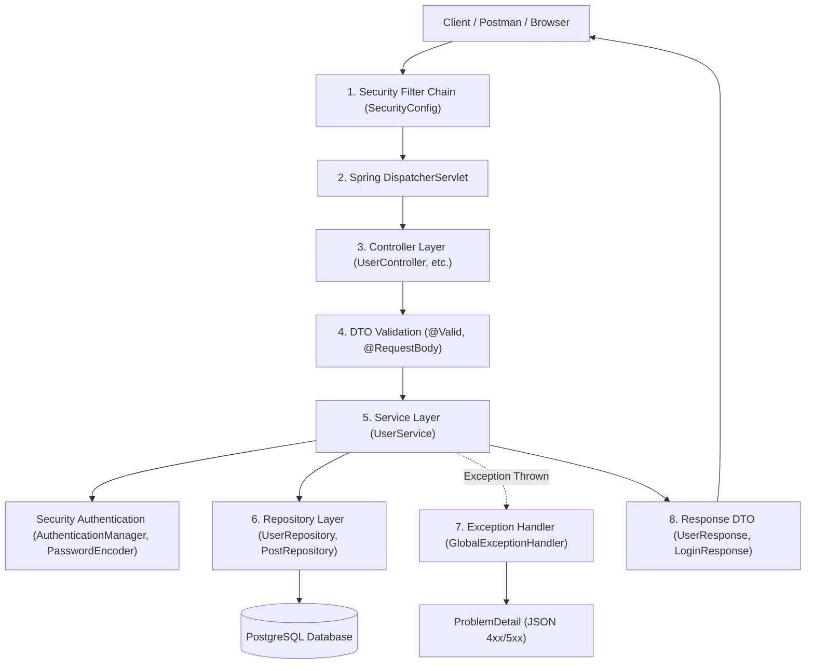
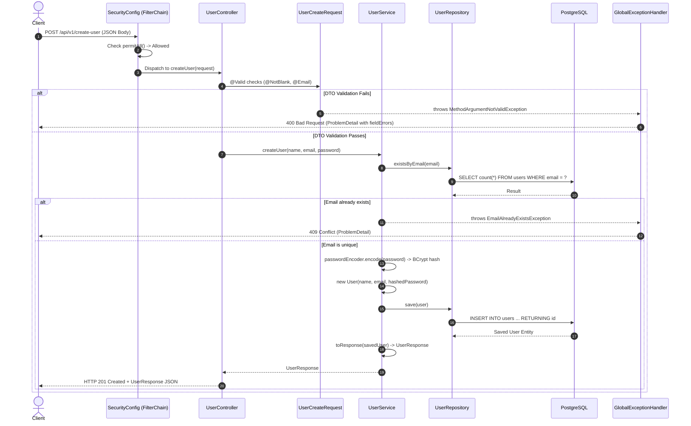
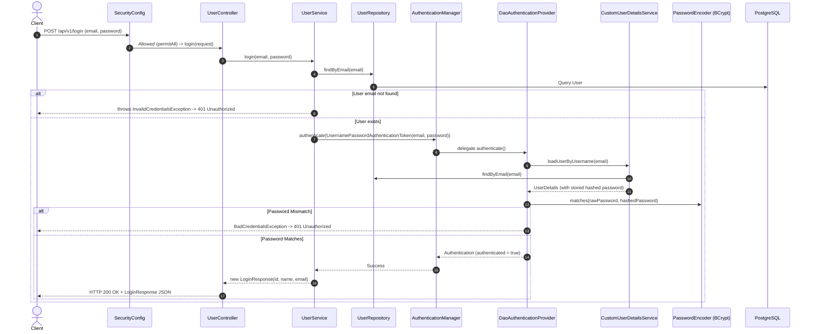
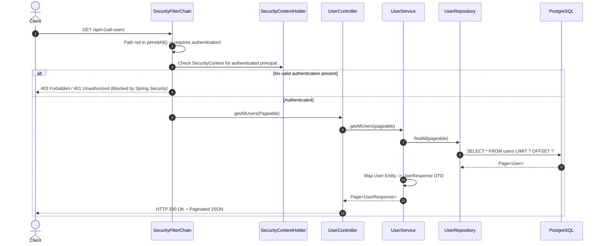
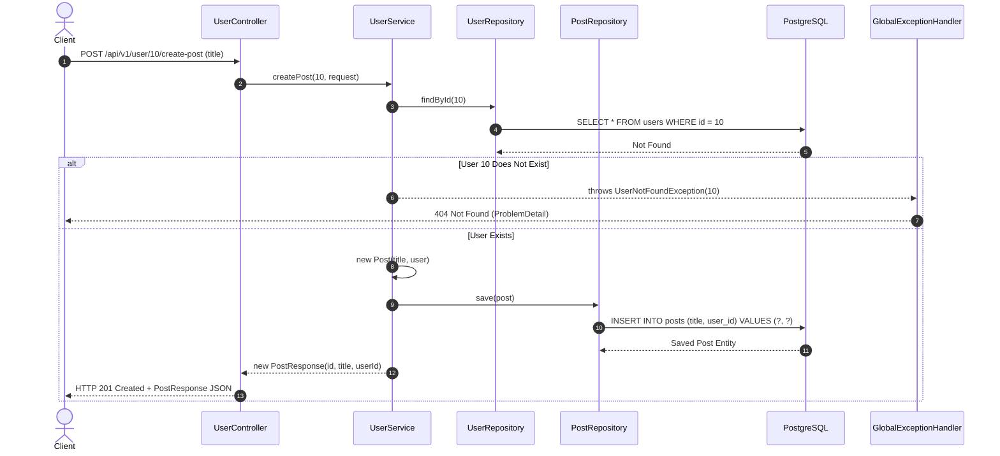

# Spring Boot Backend Architecture & Execution Flow Guide

This document explains **how the whole backend application runs**, detailing class-by-class interactions, the startup lifecycle, and request execution flows across all layers: **Security**, **Controller**, **DTO**, **Service**, **Model/Entity**, **Repository**, and **Exception Handling**.

---

## 1. High-Level Architecture Overview

Every incoming HTTP request travels through well-defined layers in a strict hierarchy:



---

## 2. All Application Components & File Directory

Here is the directory map of every key file in this project with direct links:

| Layer | Class / Interface | File Link | Responsibility |
|---|---|---|---|
| **Entry Point** | [`BackendApplication`](file:///D:/WASIMA/Backend-Folder/backend_wasima/backend/src/main/java/com/example/backend/BackendApplication.java) | [BackendApplication.java](file:///D:/WASIMA/Backend-Folder/backend_wasima/backend/src/main/java/com/example/backend/BackendApplication.java) | Boots the JVM and initializes the Spring Application Context. |
| **Config** | [`SecurityConfig`](file:///D:/WASIMA/Backend-Folder/backend_wasima/backend/src/main/java/com/example/backend/security/SecurityConfig.java) | [SecurityConfig.java](file:///D:/WASIMA/Backend-Folder/backend_wasima/backend/src/main/java/com/example/backend/security/SecurityConfig.java) | Configures CORS/CSRF, public vs protected endpoints, and security beans. |
| **Security** | [`CustomUserDetailsService`](file:///D:/WASIMA/Backend-Folder/backend_wasima/backend/src/main/java/com/example/backend/security/CustomUserDetailsService.java) | [CustomUserDetailsService.java](file:///D:/WASIMA/Backend-Folder/backend_wasima/backend/src/main/java/com/example/backend/security/CustomUserDetailsService.java) | Bridge between Spring Security and database user accounts. |
| **Security** | [`JwtService`](file:///D:/WASIMA/Backend-Folder/backend_wasima/backend/src/main/java/com/example/backend/security/JwtService.java) | [JwtService.java](file:///D:/WASIMA/Backend-Folder/backend_wasima/backend/src/main/java/com/example/backend/security/JwtService.java) | Signs and generates JWT tokens. |
| **Controller** | [`UserController`](file:///D:/WASIMA/Backend-Folder/backend_wasima/backend/src/main/java/com/example/backend/user/controller/UserController.java) | [UserController.java](file:///D:/WASIMA/Backend-Folder/backend_wasima/backend/src/main/java/com/example/backend/user/controller/UserController.java) | Handles HTTP endpoints for users, authentication, and posts. |
| **Controller** | [`HelloController`](file:///D:/WASIMA/Backend-Folder/backend_wasima/backend/src/main/java/com/example/backend/controller/HelloController.java) | [HelloController.java](file:///D:/WASIMA/Backend-Folder/backend_wasima/backend/src/main/java/com/example/backend/controller/HelloController.java) | Basic ping and status endpoints (`/`, `/hello`, `/bool`). |
| **Controller** | [`OrderController`](file:///D:/WASIMA/Backend-Folder/backend_wasima/backend/src/main/java/com/example/backend/controller/OrderController.java) | [OrderController.java](file:///D:/WASIMA/Backend-Folder/backend_wasima/backend/src/main/java/com/example/backend/controller/OrderController.java) | Handles validated order creation demo. |
| **Controller** | [`ProductController`](file:///D:/WASIMA/Backend-Folder/backend_wasima/backend/src/main/java/com/example/backend/controller/ProductController.java) | [ProductController.java](file:///D:/WASIMA/Backend-Folder/backend_wasima/backend/src/main/java/com/example/backend/controller/ProductController.java) | Multipart file + JSON object upload demo. |
| **Controller** | [`ProfileController`](file:///D:/WASIMA/Backend-Folder/backend_wasima/backend/src/main/java/com/example/backend/controller/ProfileController.java) | [ProfileController.java](file:///D:/WASIMA/Backend-Folder/backend_wasima/backend/src/main/java/com/example/backend/controller/ProfileController.java) | Form-data profile uploads with attachments. |
| **Controller** | [`FileUploadController`](file:///D:/WASIMA/Backend-Folder/backend_wasima/backend/src/main/java/com/example/backend/controller/FileUploadController.java) | [FileUploadController.java](file:///D:/WASIMA/Backend-Folder/backend_wasima/backend/src/main/java/com/example/backend/controller/FileUploadController.java) | Demonstrates single, optional, and multiple file uploads. |
| **Controller** | [`StudyNoteController`](file:///D:/WASIMA/Backend-Folder/backend_wasima/backend/src/main/java/com/example/backend/controller/StudyNoteController.java) | [StudyNoteController.java](file:///D:/WASIMA/Backend-Folder/backend_wasima/backend/src/main/java/com/example/backend/controller/StudyNoteController.java) | Reference study guide for query params, pagination, and sorting. |
| **Service** | [`UserService`](file:///D:/WASIMA/Backend-Folder/backend_wasima/backend/src/main/java/com/example/backend/user/service/UserService.java) | [UserService.java](file:///D:/WASIMA/Backend-Folder/backend_wasima/backend/src/main/java/com/example/backend/user/service/UserService.java) | Business logic for users, hashing, auth checks, and posts. |
| **Entity / Model** | [`User`](file:///D:/WASIMA/Backend-Folder/backend_wasima/backend/src/main/java/com/example/backend/user/entity/User.java) | [User.java](file:///D:/WASIMA/Backend-Folder/backend_wasima/backend/src/main/java/com/example/backend/user/entity/User.java) | JPA entity mapped to the `users` table. |
| **Entity / Model** | [`Post`](file:///D:/WASIMA/Backend-Folder/backend_wasima/backend/src/main/java/com/example/backend/user/entity/Post.java) | [Post.java](file:///D:/WASIMA/Backend-Folder/backend_wasima/backend/src/main/java/com/example/backend/user/entity/Post.java) | JPA entity mapped to the `posts` table (`@ManyToOne` with `User`). |
| **Model** | [`OrderStatus`](file:///D:/WASIMA/Backend-Folder/backend_wasima/backend/src/main/java/com/example/backend/model/OrderStatus.java) | [OrderStatus.java](file:///D:/WASIMA/Backend-Folder/backend_wasima/backend/src/main/java/com/example/backend/model/OrderStatus.java) | Enum representing lifecycle states of an order. |
| **Repository** | [`UserRepository`](file:///D:/WASIMA/Backend-Folder/backend_wasima/backend/src/main/java/com/example/backend/user/repository/UserRepository.java) | [UserRepository.java](file:///D:/WASIMA/Backend-Folder/backend_wasima/backend/src/main/java/com/example/backend/user/repository/UserRepository.java) | Spring Data JPA queries for `User` (`findByEmail`, `existsByEmail`). |
| **Repository** | [`PostRepository`](file:///D:/WASIMA/Backend-Folder/backend_wasima/backend/src/main/java/com/example/backend/user/repository/PostRepository.java) | [PostRepository.java](file:///D:/WASIMA/Backend-Folder/backend_wasima/backend/src/main/java/com/example/backend/user/repository/PostRepository.java) | Spring Data JPA interface for `Post` CRUD operations. |
| **DTO (Input)** | [`UserCreateRequest`](file:///D:/WASIMA/Backend-Folder/backend_wasima/backend/src/main/java/com/example/backend/user/dto/UserCreateRequest.java) | [UserCreateRequest.java](file:///D:/WASIMA/Backend-Folder/backend_wasima/backend/src/main/java/com/example/backend/user/dto/UserCreateRequest.java) | Validated request payload for user signup. |
| **DTO (Input)** | [`UserUpdateRequest`](file:///D:/WASIMA/Backend-Folder/backend_wasima/backend/src/main/java/com/example/backend/user/dto/UserUpdateRequest.java) | [UserUpdateRequest.java](file:///D:/WASIMA/Backend-Folder/backend_wasima/backend/src/main/java/com/example/backend/user/dto/UserUpdateRequest.java) | Validated request payload for user updates. |
| **DTO (Input)** | [`LoginRequest`](file:///D:/WASIMA/Backend-Folder/backend_wasima/backend/src/main/java/com/example/backend/user/dto/LoginRequest.java) | [LoginRequest.java](file:///D:/WASIMA/Backend-Folder/backend_wasima/backend/src/main/java/com/example/backend/user/dto/LoginRequest.java) | Validated credentials payload for user login. |
| **DTO (Input)** | [`PostCreateRequest`](file:///D:/WASIMA/Backend-Folder/backend_wasima/backend/src/main/java/com/example/backend/user/dto/PostCreateRequest.java) | [PostCreateRequest.java](file:///D:/WASIMA/Backend-Folder/backend_wasima/backend/src/main/java/com/example/backend/user/dto/PostCreateRequest.java) | Request payload for creating a post under a user. |
| **DTO (Input)** | [`OrderCreateRequest`](file:///D:/WASIMA/Backend-Folder/backend_wasima/backend/src/main/java/com/example/backend/user/dto/OrderCreateRequest.java) | [OrderCreateRequest.java](file:///D:/WASIMA/Backend-Folder/backend_wasima/backend/src/main/java/com/example/backend/user/dto/OrderCreateRequest.java) | Order creation payload demonstrating rich validation annotations. |
| **DTO (Input)** | [`ProductCreateRequest`](file:///D:/WASIMA/Backend-Folder/backend_wasima/backend/src/main/java/com/example/backend/user/dto/ProductCreateRequest.java) | [ProductCreateRequest.java](file:///D:/WASIMA/Backend-Folder/backend_wasima/backend/src/main/java/com/example/backend/user/dto/ProductCreateRequest.java) | Product creation payload used in multipart endpoints. |
| **DTO (Output)** | [`UserResponse`](file:///D:/WASIMA/Backend-Folder/backend_wasima/backend/src/main/java/com/example/backend/user/dto/UserResponse.java) | [UserResponse.java](file:///D:/WASIMA/Backend-Folder/backend_wasima/backend/src/main/java/com/example/backend/user/dto/UserResponse.java) | Safe user response hiding sensitive data (password hash). |
| **DTO (Output)** | [`LoginResponse`](file:///D:/WASIMA/Backend-Folder/backend_wasima/backend/src/main/java/com/example/backend/user/dto/LoginResponse.java) | [LoginResponse.java](file:///D:/WASIMA/Backend-Folder/backend_wasima/backend/src/main/java/com/example/backend/user/dto/LoginResponse.java) | Return payload upon successful login. |
| **DTO (Output)** | [`PostResponse`](file:///D:/WASIMA/Backend-Folder/backend_wasima/backend/src/main/java/com/example/backend/user/dto/PostResponse.java) | [PostResponse.java](file:///D:/WASIMA/Backend-Folder/backend_wasima/backend/src/main/java/com/example/backend/user/dto/PostResponse.java) | Return payload representing a user's post. |
| **Exception** | [`UserNotFoundException`](file:///D:/WASIMA/Backend-Folder/backend_wasima/backend/src/main/java/com/example/backend/user/exception/UserNotFoundException.java) | [UserNotFoundException.java](file:///D:/WASIMA/Backend-Folder/backend_wasima/backend/src/main/java/com/example/backend/user/exception/UserNotFoundException.java) | Thrown when a user ID does not exist in the database. |
| **Exception** | [`EmailAlreadyExistsException`](file:///D:/WASIMA/Backend-Folder/backend_wasima/backend/src/main/java/com/example/backend/user/exception/EmailAlreadyExistsException.java) | [EmailAlreadyExistsException.java](file:///D:/WASIMA/Backend-Folder/backend_wasima/backend/src/main/java/com/example/backend/user/exception/EmailAlreadyExistsException.java) | Thrown when registering an already registered email. |
| **Exception** | [`InvalidCredentialsException`](file:///D:/WASIMA/Backend-Folder/backend_wasima/backend/src/main/java/com/example/backend/user/exception/InvalidCredentialsException.java) | [InvalidCredentialsException.java](file:///D:/WASIMA/Backend-Folder/backend_wasima/backend/src/main/java/com/example/backend/user/exception/InvalidCredentialsException.java) | Thrown when email/password during login fails verification. |
| **Exception Advice** | [`GlobalExceptionHandler`](file:///D:/WASIMA/Backend-Folder/backend_wasima/backend/src/main/java/com/example/backend/common/exception/GlobalExceptionHandler.java) | [GlobalExceptionHandler.java](file:///D:/WASIMA/Backend-Folder/backend_wasima/backend/src/main/java/com/example/backend/common/exception/GlobalExceptionHandler.java) | Intercepts exceptions and transforms them into standardized `ProblemDetail`. |
| **Exception Advice** | [`GlobalExceptionHandler2`](file:///D:/WASIMA/Backend-Folder/backend_wasima/backend/src/main/java/com/example/backend/common/exception/GlobalExceptionHandler2.java) | [GlobalExceptionHandler2.java](file:///D:/WASIMA/Backend-Folder/backend_wasima/backend/src/main/java/com/example/backend/common/exception/GlobalExceptionHandler2.java) | Extended handler with security and mismatch error handlers. |
| **Exception DTO** | [`ApiErrorResponse`](file:///D:/WASIMA/Backend-Folder/backend_wasima/backend/src/main/java/com/example/backend/common/exception/ApiErrorResponse.java) | [ApiErrorResponse.java](file:///D:/WASIMA/Backend-Folder/backend_wasima/backend/src/main/java/com/example/backend/common/exception/ApiErrorResponse.java) | Custom error response envelope model. |
| **Properties** | `application.properties` | [application.properties](file:///D:/WASIMA/Backend-Folder/backend_wasima/backend/src/main/resources/application.properties) | Database URL, username, password, JPA/Hibernate settings. |

---

## 3. Application Startup Lifecycle (Step-by-Step)

When you execute `./mvnw spring-boot:run` or run [`BackendApplication.java`](file:///D:/WASIMA/Backend-Folder/backend_wasima/backend/src/main/java/com/example/backend/BackendApplication.java):

```text
[ JVM starts ]
      │
      ▼
BackendApplication.main(args)
      │
      ▼
SpringApplication.run(BackendApplication.class, args)
      │
      ├── 1. Read application.properties (PostgreSQL credentials, port, etc.)
      │
      ├── 2. Start Embedded Tomcat Web Server (port 8080)
      │
      ├── 3. Component Scanning (@SpringBootApplication scans package com.example.backend):
      │       ├── @Configuration: SecurityConfig
      │       ├── @Service: UserService, CustomUserDetailsService, JwtService
      │       ├── @Repository: UserRepository, PostRepository (Spring Data JPA Proxies)
      │       ├── @RestController: UserController, HelloController, OrderController, etc.
      │       └── @RestControllerAdvice: GlobalExceptionHandler
      │
      ├── 4. Dependency Injection (Constructor Injection):
      │       ├── UserRepository & PostRepository injected into UserService
      │       ├── PasswordEncoder & AuthenticationManager injected into UserService
      │       ├── UserRepository injected into CustomUserDetailsService
      │       └── UserService injected into UserController
      │
      ├── 5. Hibernate/JPA Initialization:
      │       └── Verifies/Updates database tables `users` and `posts` in PostgreSQL
      │
      └── 6. Spring Security Filter Chain built and active
```

---

## 4. Deep Dive: Layer-by-Layer Mechanics

### A. Security Layer
- **Role:** Guards the application before requests reach your controllers.
- **Key Class:** [`SecurityConfig`](file:///D:/WASIMA/Backend-Folder/backend_wasima/backend/src/main/java/com/example/backend/security/SecurityConfig.java)
- **Key Beans:**
  1. `passwordEncoder()`: Creates [`BCryptPasswordEncoder`](file:///D:/WASIMA/Backend-Folder/backend_wasima/backend/src/main/java/com/example/backend/security/SecurityConfig.java#L23-L26). Ensures passwords are never stored in plain text.
  2. `authenticationManager()`: Exposes Spring's [`AuthenticationManager`](file:///D:/WASIMA/Backend-Folder/backend_wasima/backend/src/main/java/com/example/backend/security/SecurityConfig.java#L38-L43) so [`UserService`](file:///D:/WASIMA/Backend-Folder/backend_wasima/backend/src/main/java/com/example/backend/user/service/UserService.java#L34) can trigger the authentication flow.
  3. `securityFilterChain(HttpSecurity)`:
     - Disables CSRF (`csrf.disable()`) for stateless REST APIs.
     - Sets public routes via `.requestMatchers("/", "/hello", "/bool", "/api/v1/create-user", "/api/v1/login", ...).permitAll()`.
     - Requires login for everything else (`anyRequest().authenticated()`).
- **User Detail Bridge:** [`CustomUserDetailsService`](file:///D:/WASIMA/Backend-Folder/backend_wasima/backend/src/main/java/com/example/backend/security/CustomUserDetailsService.java) implements Spring's `UserDetailsService`. It takes an email, queries [`UserRepository`](file:///D:/WASIMA/Backend-Folder/backend_wasima/backend/src/main/java/com/example/backend/user/repository/UserRepository.java#L12), and wraps the database [`User`](file:///D:/WASIMA/Backend-Folder/backend_wasima/backend/src/main/java/com/example/backend/user/entity/User.java) into a Spring Security `UserDetails` instance.

### B. Controller Layer
- **Role:** Handles incoming HTTP requests, extracts parameters, validates inputs, delegates business logic to services, and returns HTTP responses.
- **Key Annotations:**
  - `@RestController`: Combines `@Controller` and `@ResponseBody` — methods serialize return objects to JSON automatically.
  - `@PostMapping`, `@GetMapping`, `@PutMapping`, `@DeleteMapping`: Route HTTP verbs to Java methods.
  - `@RequestBody`: Deserializes raw JSON from the HTTP request body into a Java DTO object.
  - `@Valid`: Enforces validation constraints declared on the DTO. If validation fails, Spring intercepts the request and throws `MethodArgumentNotValidException` before the controller method runs.
  - `@PathVariable`: Extracts dynamic segments from the URL path (e.g., `/api/v1/user/{id}`).
  - `@ResponseStatus`: Overrides the default HTTP 200 OK with specific codes like `201 CREATED` or `204 NO_CONTENT`.

### C. DTO (Data Transfer Object) Layer
- **Role:** Decouples your internal database structure (Entity) from the external API contract.
- **Why DTOs are mandatory:**
  - **Security:** Hides sensitive entity fields such as password hashes from JSON outputs.
  - **Validation:** Captures validation constraints (`@NotBlank`, `@Email`, `@Size`, `@Positive`) without polluting database entity definitions.
  - **Contract Stability:** Changes to DB schema do not break the client frontend/API.
- **In this project:**
  - Inputs: [`UserCreateRequest`](file:///D:/WASIMA/Backend-Folder/backend_wasima/backend/src/main/java/com/example/backend/user/dto/UserCreateRequest.java), [`LoginRequest`](file:///D:/WASIMA/Backend-Folder/backend_wasima/backend/src/main/java/com/example/backend/user/dto/LoginRequest.java), [`UserUpdateRequest`](file:///D:/WASIMA/Backend-Folder/backend_wasima/backend/src/main/java/com/example/backend/user/dto/UserUpdateRequest.java), [`PostCreateRequest`](file:///D:/WASIMA/Backend-Folder/backend_wasima/backend/src/main/java/com/example/backend/user/dto/PostCreateRequest.java), [`OrderCreateRequest`](file:///D:/WASIMA/Backend-Folder/backend_wasima/backend/src/main/java/com/example/backend/user/dto/OrderCreateRequest.java).
  - Outputs: [`UserResponse`](file:///D:/WASIMA/Backend-Folder/backend_wasima/backend/src/main/java/com/example/backend/user/dto/UserResponse.java), [`LoginResponse`](file:///D:/WASIMA/Backend-Folder/backend_wasima/backend/src/main/java/com/example/backend/user/dto/LoginResponse.java), [`PostResponse`](file:///D:/WASIMA/Backend-Folder/backend_wasima/backend/src/main/java/com/example/backend/user/dto/PostResponse.java).

### D. Service Layer
- **Role:** Pure business logic coordinator. It does NOT care about HTTP headers, JSON, or status codes.
- **Key Class:** [`UserService`](file:///D:/WASIMA/Backend-Folder/backend_wasima/backend/src/main/java/com/example/backend/user/service/UserService.java)
- **Key Actions:**
  1. Checks business rules (e.g., `userRepository.existsByEmail(email)`).
  2. Encrypts passwords using `passwordEncoder.encode(rawPassword)`.
  3. Creates or mutates Entity instances.
  4. Calls repository methods to persist or fetch data.
  5. Maps Entities to Response DTOs using `toResponse()`.
  6. Throws descriptive domain exceptions when rules are violated (`UserNotFoundException`, `EmailAlreadyExistsException`, `InvalidCredentialsException`).

### E. Model / Entity Layer
- **Role:** Represents persistent domain models and defines database schema via Jakarta Persistence (JPA / Hibernate).
- **Key Classes:**
  - [`User`](file:///D:/WASIMA/Backend-Folder/backend_wasima/backend/src/main/java/com/example/backend/user/entity/User.java): Mapped to table `users`. Fields: `id`, `name`, `email` (unique), `password`, and a `@OneToMany` relationship with `Post`.
  - [`Post`](file:///D:/WASIMA/Backend-Folder/backend_wasima/backend/src/main/java/com/example/backend/user/entity/Post.java): Mapped to table `posts`. Fields: `id`, `title`, and `@ManyToOne` pointing to `User` via foreign key `user_id`.
  - [`OrderStatus`](file:///D:/WASIMA/Backend-Folder/backend_wasima/backend/src/main/java/com/example/backend/model/OrderStatus.java): Enumeration for status states.

### F. Repository Layer
- **Role:** Data access layer providing database CRUD operations.
- **Key Interfaces:**
  - [`UserRepository`](file:///D:/WASIMA/Backend-Folder/backend_wasima/backend/src/main/java/com/example/backend/user/repository/UserRepository.java): Extends `JpaRepository<User, Long>`. Automatically implements:
    - `boolean existsByEmail(String email)` ➔ Spring writes: `SELECT count(*) > 0 FROM users WHERE email = ?`
    - `Optional<User> findByEmail(String email)` ➔ Spring writes: `SELECT * FROM users WHERE email = ?`
    - `save(user)`, `findById(id)`, `findAll(pageable)`, `delete(user)`
  - [`PostRepository`](file:///D:/WASIMA/Backend-Folder/backend_wasima/backend/src/main/java/com/example/backend/user/repository/PostRepository.java): Extends `JpaRepository<Post, Long>`.

### G. Exception Handling Layer
- **Role:** Catches errors across all controllers and services, preventing raw Java stack traces from leaking to clients.
- **Key Classes:**
  - [`GlobalExceptionHandler`](file:///D:/WASIMA/Backend-Folder/backend_wasima/backend/src/main/java/com/example/backend/common/exception/GlobalExceptionHandler.java): Annotated with `@RestControllerAdvice`.
- **How it functions:**
  - When [`UserService`](file:///D:/WASIMA/Backend-Folder/backend_wasima/backend/src/main/java/com/example/backend/user/service/UserService.java#L48) throws [`EmailAlreadyExistsException`](file:///D:/WASIMA/Backend-Folder/backend_wasima/backend/src/main/java/com/example/backend/user/exception/EmailAlreadyExistsException.java), the exception bubbles up through the controller.
  - Spring's DispatcherServlet catches it and finds the matching method in [`GlobalExceptionHandler.java#L88`](file:///D:/WASIMA/Backend-Folder/backend_wasima/backend/src/main/java/com/example/backend/common/exception/GlobalExceptionHandler.java#L88):
    ```java
    @ExceptionHandler(EmailAlreadyExistsException.class)
    public ProblemDetail handleEmailAlreadyExistsException(...)
    ```
  - Formats an RFC 7807 compliant [`ProblemDetail`](file:///D:/WASIMA/Backend-Folder/backend_wasima/backend/src/main/java/com/example/backend/common/exception/GlobalExceptionHandler.java#L92) with `HttpStatus.CONFLICT` (409) and returns a clean JSON response.

---

## 5. Concrete End-to-End Execution Flows

---

### Flow 1: Create User (`POST /api/v1/create-user`)



#### Step-by-Step Code Chain:
1. **HTTP Entry**: Client sends `POST /api/v1/create-user` with `{"name": "Alice", "email": "alice@test.com", "password": "pass"}`.
2. **Security Gate**: [`SecurityConfig.java#L78`](file:///D:/WASIMA/Backend-Folder/backend_wasima/backend/src/main/java/com/example/backend/security/SecurityConfig.java#L78) matches `/api/v1/create-user` in `permitAll()`, letting it proceed.
3. **Controller Mapping**: [`UserController.java#L38-L46`](file:///D:/WASIMA/Backend-Folder/backend_wasima/backend/src/main/java/com/example/backend/user/controller/UserController.java#L38-L46) receives the request.
4. **Validation Check**: Spring checks annotations in [`UserCreateRequest.java#L8-L16`](file:///D:/WASIMA/Backend-Folder/backend_wasima/backend/src/main/java/com/example/backend/user/dto/UserCreateRequest.java#L8-L16).
5. **Business Execution**: [`UserService.java#L45-L59`](file:///D:/WASIMA/Backend-Folder/backend_wasima/backend/src/main/java/com/example/backend/user/service/UserService.java#L45-L59):
   - Calls [`UserRepository.java#L10`](file:///D:/WASIMA/Backend-Folder/backend_wasima/backend/src/main/java/com/example/backend/user/repository/UserRepository.java#L10) (`existsByEmail`).
   - Hashes password via `BCryptPasswordEncoder`.
   - Constructs [`User`](file:///D:/WASIMA/Backend-Folder/backend_wasima/backend/src/main/java/com/example/backend/user/entity/User.java#L36).
   - Persists entity via `userRepository.save(user)`.
   - Converts to [`UserResponse.java`](file:///D:/WASIMA/Backend-Folder/backend_wasima/backend/src/main/java/com/example/backend/user/dto/UserResponse.java) (without password).
6. **HTTP Return**: Controller responds with `201 CREATED` containing `UserResponse`.

---

### Flow 2: User Login (`POST /api/v1/login`)



#### Step-by-Step Code Chain:
1. **HTTP Entry**: Client sends `POST /api/v1/login` with email and raw password.
2. **Security Gate**: [`SecurityConfig.java#L79`](file:///D:/WASIMA/Backend-Folder/backend_wasima/backend/src/main/java/com/example/backend/security/SecurityConfig.java#L79) allows the route.
3. **Controller**: [`UserController.java#L48-L54`](file:///D:/WASIMA/Backend-Folder/backend_wasima/backend/src/main/java/com/example/backend/user/controller/UserController.java#L48-L54) validates [`LoginRequest`](file:///D:/WASIMA/Backend-Folder/backend_wasima/backend/src/main/java/com/example/backend/user/dto/LoginRequest.java) and calls `userService.login()`.
4. **Service Verification**: [`UserService.java#L64-L78`](file:///D:/WASIMA/Backend-Folder/backend_wasima/backend/src/main/java/com/example/backend/user/service/UserService.java#L64-L78):
   - Confirms user exists via [`UserRepository.java#L12`](file:///D:/WASIMA/Backend-Folder/backend_wasima/backend/src/main/java/com/example/backend/user/repository/UserRepository.java#L12). If not, throws [`InvalidCredentialsException`](file:///D:/WASIMA/Backend-Folder/backend_wasima/backend/src/main/java/com/example/backend/user/exception/InvalidCredentialsException.java).
   - Bundles credentials into `UsernamePasswordAuthenticationToken`.
   - Delegates to `authenticationManager.authenticate(...)`.
5. **Spring Security Engine**:
   - `AuthenticationManager` invokes `DaoAuthenticationProvider`.
   - `DaoAuthenticationProvider` calls [`CustomUserDetailsService.java#L22-L34`](file:///D:/WASIMA/Backend-Folder/backend_wasima/backend/src/main/java/com/example/backend/security/CustomUserDetailsService.java#L22-L34) to load stored hashed password.
   - BCrypt checks if `matches(rawPassword, storedHash)` is `true`.
6. **Return**: [`LoginResponse.java`](file:///D:/WASIMA/Backend-Folder/backend_wasima/backend/src/main/java/com/example/backend/user/dto/LoginResponse.java) is created and sent back with `200 OK`.

---

### Flow 3: Protected Resource Access (`GET /api/v1/all-users`)



#### Step-by-Step Code Chain:
1. **Security Inspection**: Request targets `/api/v1/all-users`. In [`SecurityConfig.java#L83`](file:///D:/WASIMA/Backend-Folder/backend_wasima/backend/src/main/java/com/example/backend/security/SecurityConfig.java#L83), this endpoint falls under `.anyRequest().authenticated()`.
2. **If Unauthenticated**: Spring Security immediately terminates the request with `403 Forbidden` (controller is never executed).
3. **If Authenticated**: Handed to [`UserController.java#L56-L59`](file:///D:/WASIMA/Backend-Folder/backend_wasima/backend/src/main/java/com/example/backend/user/controller/UserController.java#L56-L59).
4. **Service**: [`UserService.java#L86-L90`](file:///D:/WASIMA/Backend-Folder/backend_wasima/backend/src/main/java/com/example/backend/user/service/UserService.java#L86-L90) requests a paginated subset from [`UserRepository`](file:///D:/WASIMA/Backend-Folder/backend_wasima/backend/src/main/java/com/example/backend/user/repository/UserRepository.java).
5. **Entity Mapping**: Each [`User`](file:///D:/WASIMA/Backend-Folder/backend_wasima/backend/src/main/java/com/example/backend/user/entity/User.java) is converted to a [`UserResponse`](file:///D:/WASIMA/Backend-Folder/backend_wasima/backend/src/main/java/com/example/backend/user/dto/UserResponse.java) through `toResponse()`.

---

### Flow 4: Create Post Under User (`POST /api/v1/user/{userId}/create-post`)



#### Step-by-Step Code Chain:
1. **Controller**: [`UserController.java#L81-L87`](file:///D:/WASIMA/Backend-Folder/backend_wasima/backend/src/main/java/com/example/backend/user/controller/UserController.java#L81-L87) extracts `userId` from path and validates [`PostCreateRequest.java`](file:///D:/WASIMA/Backend-Folder/backend_wasima/backend/src/main/java/com/example/backend/user/dto/PostCreateRequest.java).
2. **Service Lookup**: [`UserService.java#L126-L143`](file:///D:/WASIMA/Backend-Folder/backend_wasima/backend/src/main/java/com/example/backend/user/service/UserService.java#L126-L143):
   - Calls `userRepository.findById(userId)`.
   - If missing, throws [`UserNotFoundException`](file:///D:/WASIMA/Backend-Folder/backend_wasima/backend/src/main/java/com/example/backend/user/exception/UserNotFoundException.java).
   - If found, instantiates [`Post`](file:///D:/WASIMA/Backend-Folder/backend_wasima/backend/src/main/java/com/example/backend/user/entity/Post.java#L28) associating the user entity (`@ManyToOne`).
   - Persists through [`PostRepository.java`](file:///D:/WASIMA/Backend-Folder/backend_wasima/backend/src/main/java/com/example/backend/user/repository/PostRepository.java).
   - Returns [`PostResponse.java`](file:///D:/WASIMA/Backend-Folder/backend_wasima/backend/src/main/java/com/example/backend/user/dto/PostResponse.java).

---

## 6. Summary Cheat Sheet: Who Calls Whom?

| Source Class | Target Class / Interface | Invoked Method / Interaction | Why it happens |
|---|---|---|---|
| [`BackendApplication`](file:///D:/WASIMA/Backend-Folder/backend_wasima/backend/src/main/java/com/example/backend/BackendApplication.java) | `SpringApplication` | `.run(...)` | Launches application context and embeds Tomcat server. |
| Tomcat / Servlet Container | [`SecurityConfig`](file:///D:/WASIMA/Backend-Folder/backend_wasima/backend/src/main/java/com/example/backend/security/SecurityConfig.java) | `securityFilterChain` | Evaluates if request is permitted or requires authentication. |
| `DispatcherServlet` | [`UserController`](file:///D:/WASIMA/Backend-Folder/backend_wasima/backend/src/main/java/com/example/backend/user/controller/UserController.java) | `@PostMapping`, `@GetMapping`, etc. | Routes HTTP method & URL path to controller Java method. |
| [`UserController`](file:///D:/WASIMA/Backend-Folder/backend_wasima/backend/src/main/java/com/example/backend/user/controller/UserController.java) | [`UserService`](file:///D:/WASIMA/Backend-Folder/backend_wasima/backend/src/main/java/com/example/backend/user/service/UserService.java) | `createUser(...)`, `login(...)`, `getuserById(...)` | Controller delegates business tasks to service layer. |
| [`UserService`](file:///D:/WASIMA/Backend-Folder/backend_wasima/backend/src/main/java/com/example/backend/user/service/UserService.java) | `PasswordEncoder` | `.encode(password)` | Encrypts raw password with BCrypt before persistence. |
| [`UserService`](file:///D:/WASIMA/Backend-Folder/backend_wasima/backend/src/main/java/com/example/backend/user/service/UserService.java) | `AuthenticationManager` | `.authenticate(token)` | Triggers Spring Security's authentication evaluation. |
| `AuthenticationManager` | [`CustomUserDetailsService`](file:///D:/WASIMA/Backend-Folder/backend_wasima/backend/src/main/java/com/example/backend/security/CustomUserDetailsService.java) | `.loadUserByUsername(email)` | Looks up user from database to compare hashed credentials. |
| [`CustomUserDetailsService`](file:///D:/WASIMA/Backend-Folder/backend_wasima/backend/src/main/java/com/example/backend/security/CustomUserDetailsService.java) | [`UserRepository`](file:///D:/WASIMA/Backend-Folder/backend_wasima/backend/src/main/java/com/example/backend/user/repository/UserRepository.java) | `.findByEmail(email)` | SQL lookup to retrieve password hash and user record. |
| [`UserService`](file:///D:/WASIMA/Backend-Folder/backend_wasima/backend/src/main/java/com/example/backend/user/service/UserService.java) | [`UserRepository`](file:///D:/WASIMA/Backend-Folder/backend_wasima/backend/src/main/java/com/example/backend/user/repository/UserRepository.java) | `.save(user)`, `.findById(id)` | Executes SQL queries through Spring Data JPA. |
| [`UserService`](file:///D:/WASIMA/Backend-Folder/backend_wasima/backend/src/main/java/com/example/backend/user/service/UserService.java) | [`PostRepository`](file:///D:/WASIMA/Backend-Folder/backend_wasima/backend/src/main/java/com/example/backend/user/repository/PostRepository.java) | `.save(post)`, `.findById(userId)` | Executes SQL operations on `posts` table. |
| Any Service / Controller | [`GlobalExceptionHandler`](file:///D:/WASIMA/Backend-Folder/backend_wasima/backend/src/main/java/com/example/backend/common/exception/GlobalExceptionHandler.java) | `@ExceptionHandler(...)` | Catches unhandled exceptions and returns standardized JSON errors. |
